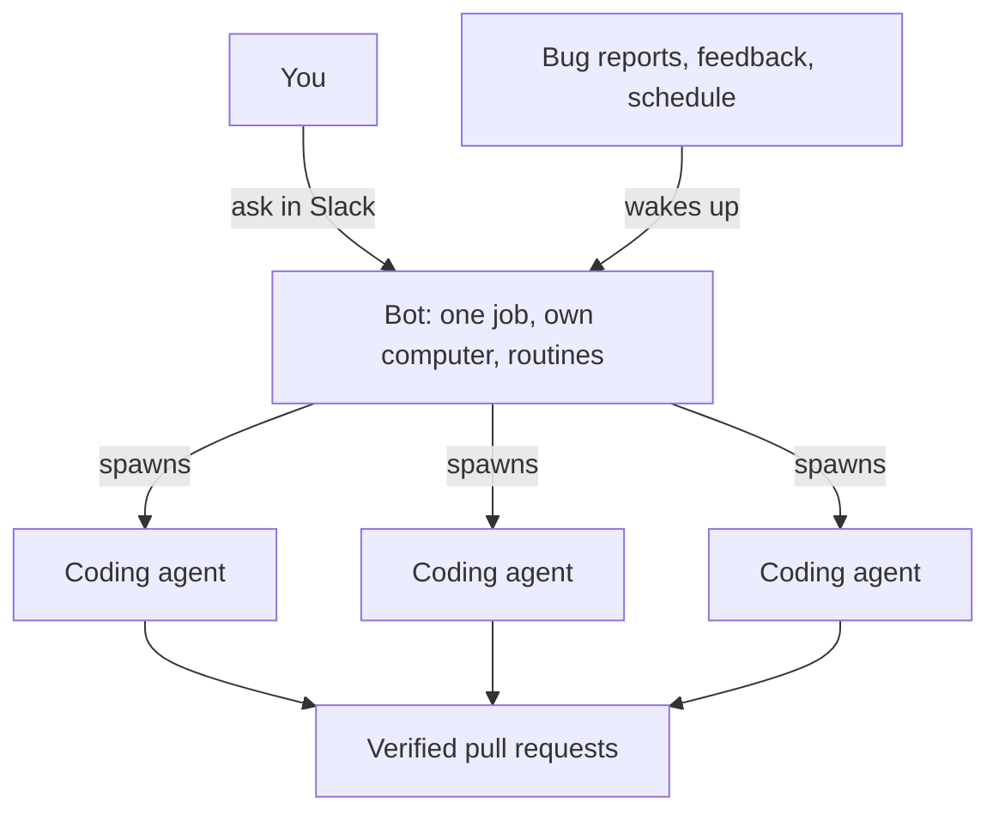

# Agents vs bots

"AI" in a software engineer's day now covers three quite different things. Mixing them up is the most common reason people are disappointed with it.

## Three levels

| | Chat assistant | Agent | Bot |
| --- | --- | --- | --- |
| **What it is** | A model you talk to | A model that calls tools in a loop until a task is done | A standing, named worker with its own computer, access and schedule |
| **Who drives** | You, every turn | You set the task; it takes the steps | It wakes itself up on a schedule or an event |
| **Lifetime** | One conversation | One task | Weeks or months |
| **Typical job** | "Explain this error" | "Fix this bug and open a PR" | "Every morning, triage new bug reports and start agents on the clear ones" |
| **Your role** | Typist and reviewer | Task-setter and reviewer | Manager |

### Chat

You paste code, it answers, you copy the answer back. The model never sees the result of its suggestion, so it can't notice when it's wrong. You are the loop.

### Agent

An **agent** is a language model given **tools** (read a file, edit a file, run a command, open a browser) and allowed to call them repeatedly. It reads the test output, sees the failure, edits again. Claude Code, Cursor's agent and similar tools all work this way. Cloud agents do the same thing on a remote machine so you can run many at once.

The key shift: the agent can **observe the consequences of its own actions**. That's what makes it more than autocomplete, and it's the subject of the next lesson.

### Bot

A **bot**, in the sense Lauren Tan uses for Grok Bot, sits one level up. Her launch post describes bots that "do work on their own computers while you're at meetings, while you're having lunch, and while you sleep." A bot:

- has a **name and one job** (an "engineer bot", a "chief of staff" bot, a feedback-triage bot),
- has **its own machine, credentials and skills**,
- runs **routines**: scheduled or event-triggered jobs. She has described the loops as essentially "crons with webhooks on top of skill files",
- and, crucially, **spawns agents** to do the actual coding.

A guide compiled from her posts sums it up as: **"Bots are managers, not coders."** You talk to a bot (for example in Slack), the bot breaks the work up and starts cloud agents, and the agents write and verify the code.

She also says she still picks the tool to fit the job: smaller and medium tasks go to a bot, while her really big projects go to an editor where she can manage "a lot of subagents (like hundreds)" ([post](https://x.com/poteto/status/2092852684751781905)).

## Which one should you use?

Climb the ladder only as far as your trust goes. A teammate of hers described a three-step adoption ladder on a podcast:

1. **Read-only answers.** The AI explains, searches and summarises. Nothing it does can break anything.
2. **End-to-end tasks.** The AI changes code and opens a PR, and you check the result.
3. **Owning a responsibility.** The AI does a recurring job (like triaging bugs) with little supervision.

They said even their team is "still quite far away" from step three for most work. For a learner, step 1 and step 2 are where nearly all the value is.

:::tip[Try it]
Pick one small, real task from this course, such as "add a `## Watch` section to a lesson" or "fix a typo in a notebook". Do it three ways: in a chat window (copy and paste), with an agent in your editor, and (if you have one) as a background cloud agent. Write down in `notes/` how many times you had to step in for each.
:::

## Watch

<YouTube id="A63sedG-p5Q" title="Are Agents About to Replace Software Engineering? | Lauren Tan and Roshan Sadanani" channel="MTS">

A conversation about where agents are taking the job of a software engineer. Good background for this whole part.

</YouTube>

## Check your understanding

<MultipleChoice
  id="agents-bots-1"
  question="What is the key thing an agent can do that a chat assistant can't?"
  options={[
    "Write longer answers",
    "Use a bigger model",
    "Act with tools and observe the results of its own actions, then try again",
    "Remember every previous conversation",
  ]}
  answer={2}
  explanation="An agent runs commands, reads the output and corrects itself. In a chat, you are the one carrying results back and forth."
/>

<MultipleChoice
  id="agents-bots-2"
  question="In Lauren Tan's framing, what does a bot mostly do?"
  options={[
    "Writes all the code itself in one long conversation",
    "Acts as a manager: it has one job and routines, and spawns coding agents to do the work",
    "Replaces the need for code review entirely",
    "Answers questions but never changes anything",
  ]}
  answer={1}
  explanation="“Bots are managers, not coders.” A bot is long-lived and wakes on schedules or events; the coding is done by agents it starts."
/>

<MultipleChoice
  id="agents-bots-3"
  question="You've just started using AI for coding and don't yet trust its changes. Which step of the adoption ladder fits best?"
  options={[
    "Give a bot ownership of your bug queue",
    "Start 50 cloud agents in parallel",
    "Read-only use: explanations, searches and summaries",
    "Let agents merge their own PRs",
  ]}
  answer={2}
  explanation="Trust comes first. Start where mistakes are harmless, then move to end-to-end tasks you check yourself."
/>

<OpenQuestion
  id="agents-bots-4"
  question="Describe one recurring job from your own work (or from this course) that could become a bot. Give it a name, one job, its trigger and what agents it would start.">

**Worked example:**

- **Name:** Lesson-checker bot.
- **One job:** keep every lesson on this site building and consistent.
- **Trigger:** each new pull request, plus a weekly routine on Monday morning.
- **What it does:** runs the site build and reads the errors. For each failure it starts one coding agent with a clear finish condition, for example "the build passes and question ids are unique".
- **What it must not do (anti-jobs):** write new lessons, or merge anything that touches the deploy workflow.

Notice the shape: one narrow job, a trigger, and agents doing the actual edits. A bot with a vague job ("improve the site") tends to produce a pile of unrelated changes.

</OpenQuestion>
