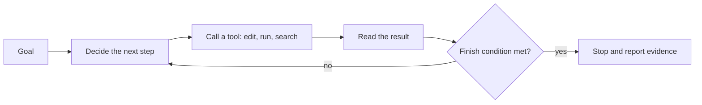
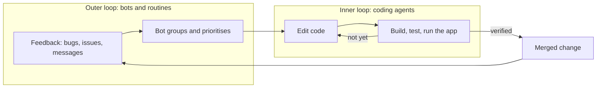

# Loops

Every agent is a loop. Getting better results from agents is mostly about making that loop tighter, longer-running and honest about when it's finished.

## The basic agent loop

This should look familiar. It's the same shape as the [core loop of machine learning](../foundations/the-core-loop.md) (predict, measure error, adjust) and as an [RL agent](../reinforcement-learning/rl-basics.md) (observe, act, get reward). In all three, **the quality of the feedback signal decides the quality of the result**.

For a coding agent, the feedback is whatever it can observe: compiler errors, lint output, test results, a screenshot of the running app. If the only feedback is "the code looks plausible", the loop has nothing to push against, and it will stop as soon as the code *looks* done.

:::tip[The most important part of a loop]
Lauren Tan has called verification "the most important part of a loop that allows it to be a loop." Without a way to check its own work, an agent isn't looping toward a goal. It's just generating until it runs out of ideas.
:::

## Inner loop and outer loop

She describes two loops stacked together:

- **Inner loop:** an agent (or a group of agents) works on code toward a snapshot of what you intend: edit, build, test, look at the running app, repeat.
- **Outer loop:** the world feeding new work in: bug reports, customer feedback, Slack threads, issues. Bots and routines live here, turning that feedback into tasks for the inner loop.

Her warning about the order you build these in is blunt: **"if your inner coding loop produces slop, then automating that loop just produces more slop."** Make one agent reliably produce good, verified work before you add the outer loop or run many in parallel.

## Running a loop for a long time

Tools now let an agent keep going for hours. Cursor has a `/loop` command, and Claude Code has a similar `/loop` that reruns a prompt on an interval or lets the agent pace itself. The pstack README says its main skill "works extremely well with cursor's `/loop` command. you can make cursor work for many hours without sacrificing rigor."

A long, unattended loop needs a clear contract. A guide compiled from her posts lists the pieces of an "overnight" run:

1. **Goal.** What you actually want, in a sentence or two.
2. **Finish condition.** Concrete and checkable: "all tests in `tests/quiz` pass and the site builds", not "make the quiz better".
3. **Permissions.** What it may and may not touch (for example, never push to `main`).
4. **Escape hatch.** When to stop and ask instead of guessing.
5. **The loop itself.** For example `/loop` with that prompt.
6. **Decision log.** A file where it writes down what it tried and why, so you can review the reasoning in the morning.

Two more rules from the same guide:

- **A plateau means pivot.** If several iterations in a row don't move the measure, the agent should change approach rather than keep nudging. (This is the same idea as noticing a flat loss curve in [Debugging training](../training-from-scratch/debugging-training.md).)
- **Don't report success off a green build alone.** A build passing proves it compiles, not that the feature works.

## Loops and cost

A loop on a schedule runs more often than you think. The same guide points out that "a 15 min routine runs almost 100 times a day." Run routines as rarely as the job allows, and make each run cheap to skip when there's nothing to do.

## Watch

<YouTube id="MN9dGgmLyso" title="LIVE: Poteto (creator of pstack) on shipping 1,000's of PR's a month at SpaceX" channel="Matt Pocock">

An hour-long livestream. She walks through her inner and outer loops, how verification makes them work, and how she turns repeated corrections into reusable skills and tools.

</YouTube>

## Check your understanding

<MultipleChoice
  id="agent-loops-1"
  question="Why is verification called the part that lets a loop be a loop?"
  options={[
    "It makes the model faster",
    "Without a check of its own work, the agent has no signal to decide whether to keep going or stop",
    "It reduces token usage to zero",
    "It's required by the agent's licence",
  ]}
  answer={1}
  explanation="Like a loss function in training, verification is the feedback. No feedback means the agent stops when the code merely looks finished."
/>

<MultipleChoice
  id="agent-loops-2"
  question="Which should you build first?"
  options={[
    "An outer loop that turns every bug report into an agent",
    "Fifty parallel cloud agents",
    "An inner loop where one agent reliably produces verified work",
    "A dashboard of how many PRs you ship",
  ]}
  answer={2}
  explanation="Automating a loop that produces slop just produces more slop. Harden the inner loop, then scale it."
/>

<MultipleChoice
  id="agent-loops-3"
  question="Which is the best finish condition for an overnight agent run?"
  options={[
    "Make the site nicer",
    "Keep working until you're confident",
    "Every lesson in docs/ai-agents builds with no warnings, and each has a Check your understanding section with unique ids",
    "Stop after 8 hours",
  ]}
  answer={2}
  explanation="A good finish condition is concrete and checkable by the agent itself. A time limit is a useful safety net, but it's not a definition of done."
/>

<MultipleChoice
  id="agent-loops-4"
  question="Your agent has tried five small variations and the failing test count hasn't changed. What does 'a plateau means pivot' suggest?"
  options={[
    "Try a sixth small variation",
    "Delete the failing tests",
    "Step back, question the approach, and try something structurally different (or stop and ask)",
    "Declare success",
  ]}
  answer={2}
  explanation="Repeated nudges with no progress mean the approach is wrong. Deleting or skipping tests to get green is never the answer."
/>

<OpenQuestion
  id="agent-loops-5"
  question="Write an overnight contract for an agent that should add a 'Watch' section with one video to every lesson in Part 2 that doesn't have one. Include all six parts.">

**Worked example:**

1. **Goal:** every lesson in `site/docs/classical-ml/` has a `## Watch` section with one relevant, beginner-friendly video, placed just before `## Check your understanding`.
2. **Finish condition:** each of those files contains exactly one `## Watch` heading; every `<YouTube id>` was confirmed to exist (title and channel match the real video); `npm run build` in `site/` passes.
3. **Permissions:** may edit files in `site/docs/classical-ml/` only. Must work on a branch and open a PR. Must never push to `main`.
4. **Escape hatch:** if no good video exists for a lesson, or a video can't be verified, leave that lesson alone and note it in the log instead of guessing an id.
5. **Loop:** run with `/loop`, letting the agent pace itself, one lesson per iteration.
6. **Decision log:** `notes/watch-sections-log.md`, one line per lesson: the video chosen, why, and how its id was checked.

The escape hatch matters most here. An agent under pressure to finish will happily invent a plausible-looking video id. Telling it what to do when it can't verify one removes that shortcut.

</OpenQuestion>
