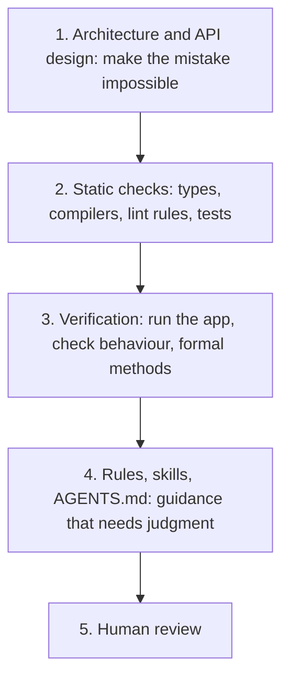

# Trust and the environment

The central claim of Lauren Tan's talk *All Code Is Slop (Except Mine)* is that getting more out of agents is "all about trust. Not blind trust, but investing in your agents' environment so you can trust that your agents are going to do the right thing."

Put differently: **stop trying to write a better prompt, and start building a codebase where the wrong thing is hard to do.**

## Agents love shortcuts

An agent wants to reach its finish condition. If there's a shortcut that makes the check pass without solving the real problem, it will often take it: a `setTimeout` to hide a race condition, a comment explaining why a workaround is fine, a test that only checks the mock. Her team's principle is to **make the shortcut the correct path**.

Agents also **copy what they see**. Every anti-pattern already in your codebase is, in her words, "now likely to be just copied by the next agent." The codebase is the agent's memory and its main example of "how we do things here".

That's why she says the engineer's job "is kind of becoming like gardening": pull out bad patterns before they spread, and keep the codebase pristine because it's what every future agent learns from.

## The inverted pyramid

Her talk ranks the ways to correct an agent, from strongest to weakest. Reach for the strongest layer that can catch the problem.



| Layer | Example | Why it's strong or weak |
| --- | --- | --- |
| **Architecture** | Their internal framework bans `useEffect` in product code; you simply can't call it | The problem "categorically" disappears. No tokens spent on it ever again |
| **Static checks** | A lint rule and dependency checker forbid Electron main-process code from importing renderer code | Deterministic, runs every time, cheap |
| **Verification** | The agent drives the real app and checks the feature works | Proves behaviour, but not code quality or speed |
| **Rules and skills** | A line in `AGENTS.md` saying "don't import renderer code from main" | The model may ignore it, misread it, or lose it in a long context |
| **Human review** | You read the diff | Slow and doesn't scale to many agents |

Her rule of thumb: **"make that a deterministic check instead of adding another line to your rules or your AGENTS.md."** It's "far more reproducible when it's in code and it lets you trust it more." And: "every time we correct our agents, it turns into one of these deterministic checks."

On the Electron rule, she put the payoff simply: "It's tokens I don't have to spend anymore."

## Write error messages for the agent

When a lint rule fires, the agent reads the error message. A good message explains **the root cause and the fix**, not just "this is banned". Compare:

- Weak: `no-set-timeout: setTimeout is not allowed.`
- Strong: `no-set-timeout: timers hide ordering bugs. Find the event you're waiting for and react to it instead (see docs/async.md).`

The weak version invites the agent to find another way to wait. The strong version steers it to the real fix.

## Some of her team's concrete rules

- **Ban most comments.** Agents used comments to justify not fixing the root cause, and comments go stale. They banned "99% of comments".
- **Ban timer workarounds** (`setTimeout`, `requestAnimationFrame`, `requestIdleCallback`) in places where agents used them to paper over bugs.
- **Delete existing tech debt**, because agents will copy it. Add a lint rule to stop new cases first ("stop the bleeding"), then clean up the old ones.

## A worked example from this site

This site already does this in a small way. Each quiz question needs a unique `id` so your saved answers don't collide. Instead of a note in a README saying "please keep ids unique", **the build fails** if two questions share an id. An agent editing lessons can't get that wrong and still pass.

Compare a rule that is only written down: admonition titles must use `:::tip[Title]`, because `:::tip Title` renders the title as plain text. An agent (or a person) can easily get this wrong, and nothing stops them. That's a candidate for promotion to a check.

:::tip[Try it]
Open any project you work on and find one instruction that lives only in prose: a README line, a code-review comment you keep repeating, or a line in an `AGENTS.md` or `CLAUDE.md`. Write down which pyramid layer could enforce it instead, and what the error message would say.
:::

## Watch

<YouTube id="O_zcc6Xl12g" title="All Code Is Slop (Except Mine) — Lauren Tan" channel="AI Engineer">

The 17-minute talk this lesson is built on: the inverted pyramid, gardening your codebase, verification artifacts, and how her team keeps quality high at very high volume.

</YouTube>

## Check your understanding

<MultipleChoice
  id="agent-trust-1"
  question="Your agent keeps importing a server-only module into browser code. Which fix is strongest?"
  options={[
    "Add a bold line to AGENTS.md",
    "Remind it in every prompt",
    "Add a lint rule or dependency check that fails the build, with an error that explains the right import",
    "Review every diff yourself",
  ]}
  answer={2}
  explanation="A deterministic check runs every time and costs no attention or tokens. Prose rules are the weakest layer."
/>

<MultipleChoice
  id="agent-trust-2"
  question="Why does existing tech debt matter more when agents write your code?"
  options={[
    "Agents refuse to work in messy code",
    "Agents treat the codebase as their example, so they copy anti-patterns they find",
    "Tech debt makes the model slower",
    "It doesn't matter any more",
  ]}
  answer={1}
  explanation="The codebase is the agent's memory. Every bad pattern you leave is a pattern the next agent may repeat."
/>

<MultipleChoice
  id="agent-trust-3"
  question="What does 'make the shortcut the correct path' mean?"
  options={[
    "Let agents skip tests when they're in a hurry",
    "Design APIs and checks so the easiest way to pass is also the right way",
    "Use the shortest possible prompts",
    "Always pick the fastest model",
  ]}
  answer={1}
  explanation="Agents will take the cheapest route to their finish condition. Shape the environment so that route is the one you want."
/>

<OpenQuestion
  id="agent-trust-4"
  question="Pick the admonition rule from this page (titles must use :::tip[Title]) and design a deterministic check for it. What would it scan, what would it reject, and what would its error message say?">

**Worked example:**

- **What it scans:** every `.md` and `.mdx` file under `site/docs/`.
- **What it rejects:** any line that starts with `:::` followed by an admonition type (`note`, `tip`, `info`, `warning`, `danger`) and then a space and more text, for example `:::tip Try it`. The pattern is roughly `^:::(note|tip|info|warning|danger) \S`.
- **Where it runs:** as a step before `npm run build`, and in the GitHub Actions workflow, so it fails both locally and on the PR.
- **Error message:**

  ```text
  docs/foo.md:12  Admonition title must be in brackets.
  Found:   :::tip Try it
  Use:     :::tip[Try it]
  Without brackets, Docusaurus renders the title as body text.
  ```

The message names the file and line, shows the exact fix, and explains *why*, so an agent fixes it properly first time instead of guessing. Once this check exists, the line about admonitions in any instructions file can be deleted.

</OpenQuestion>
