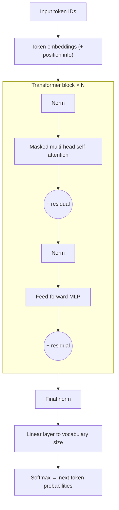

# The transformer

The transformer was introduced in the 2017 paper *"Attention Is All You Need"*. Nearly every frontier AI model since, for text, images, audio and code, is built from it. Now that you know about [embeddings](./embeddings.md), [attention](./attention.md) and [residual blocks](../neural-networks/regularisation.md#residual-connections), you have all the parts.

## A decoder-only transformer (GPT-style)

LLMs like GPT, Llama, Qwen and Mistral use the **decoder-only** variant:



Each block does two things:

1. **Attention** mixes information *between* tokens.
2. **Feed-forward** (an MLP applied to each token on its own) processes information *within* each token. Most of a model's parameters, and arguably much of its stored knowledge, live here.

Each has a residual connection around it, so the token vectors flow through the network as a "residual stream" that every layer reads from and adds to.

## In code

```python
class Block(nn.Module):
    def __init__(self, dim, n_heads):
        super().__init__()
        self.ln1 = nn.LayerNorm(dim)
        self.attn = nn.MultiheadAttention(dim, n_heads, batch_first=True)
        self.ln2 = nn.LayerNorm(dim)
        self.mlp = nn.Sequential(nn.Linear(dim, 4 * dim), nn.GELU(), nn.Linear(4 * dim, dim))

    def forward(self, x):
        T = x.shape[1]
        causal = torch.triu(torch.ones(T, T, dtype=torch.bool, device=x.device), diagonal=1)
        h = self.ln1(x)
        x = x + self.attn(h, h, h, attn_mask=causal, need_weights=False)[0]
        x = x + self.mlp(self.ln2(x))
        return x


class GPT(nn.Module):
    def __init__(self, vocab_size, dim=384, n_heads=6, n_layers=6, max_len=256):
        super().__init__()
        self.tok = nn.Embedding(vocab_size, dim)
        self.pos = nn.Embedding(max_len, dim)
        self.blocks = nn.Sequential(*[Block(dim, n_heads) for _ in range(n_layers)])
        self.ln_f = nn.LayerNorm(dim)
        self.head = nn.Linear(dim, vocab_size, bias=False)

    def forward(self, idx):                       # idx: (B, T) token IDs
        T = idx.shape[1]
        x = self.tok(idx) + self.pos(torch.arange(T, device=idx.device))
        x = self.blocks(x)
        return self.head(self.ln_f(x))            # (B, T, vocab_size) logits
```

That's a complete GPT. With these default sizes it has about 10M parameters and trains well on a 3070. You'll do exactly that in the [capstone](../training-from-scratch/capstone-tiny-gpt.md).

## Training objective

At every position, predict the next token. If the input is tokens `[t0, t1, t2, t3]`, the targets are `[t1, t2, t3, t4]`. One sequence of length $T$ gives $T$ training examples at once, thanks to the causal mask. The loss is the cross-entropy averaged over all positions.

## Generating text

To generate, repeatedly:

1. Run the model on the tokens so far.
2. Take the logits for the **last** position and turn them into probabilities.
3. **Sample** a token from those probabilities (or pick the most likely one).
4. Append it and repeat.

Sampling knobs you'll see everywhere:

- **Temperature:** divide logits by $T$ before softmax. Below 1 is more focused and repetitive; above 1 is more random.
- **Top-k:** only sample from the $k$ most likely tokens.
- **Top-p (nucleus):** only sample from the smallest set of tokens whose probabilities add up to $p$.

## Variants

| Variant | Examples | Used for |
| --- | --- | --- |
| Encoder-only | BERT, RoBERTa | Understanding: classification, embeddings, search. Sees the whole input (no causal mask). |
| Decoder-only | GPT, Llama, Qwen, Mistral, Gemma | Generating text. The dominant LLM design. |
| Encoder-decoder | T5, original transformer, Whisper | Input-to-output tasks like translation and speech-to-text. |

## What changed between GPT-2 and modern LLMs

The core is the same. The refinements:

- **RMSNorm** instead of LayerNorm, applied before each sub-layer (pre-norm).
- **RoPE** rotary position embeddings instead of learned positions, which handle longer contexts better.
- **SwiGLU** activations in the MLP.
- **Grouped-query attention (GQA):** several query heads share each key/value head, shrinking the KV cache.
- **Mixture of experts (MoE)** in some models: many MLPs per layer, and a router picks a few per token. More total parameters, same compute per token.
- And above all: **much more data and much more compute.**

:::tip Try it
Read [The Illustrated Transformer](https://jalammar.github.io/illustrated-transformer/) by Jay Alammar for a visual walk-through. Then copy the `GPT` class above into a notebook, instantiate it with a vocabulary of 65 (characters), and check that a random input of shape `(4, 32)` produces logits of shape `(4, 32, 65)`. Count its parameters.
:::
