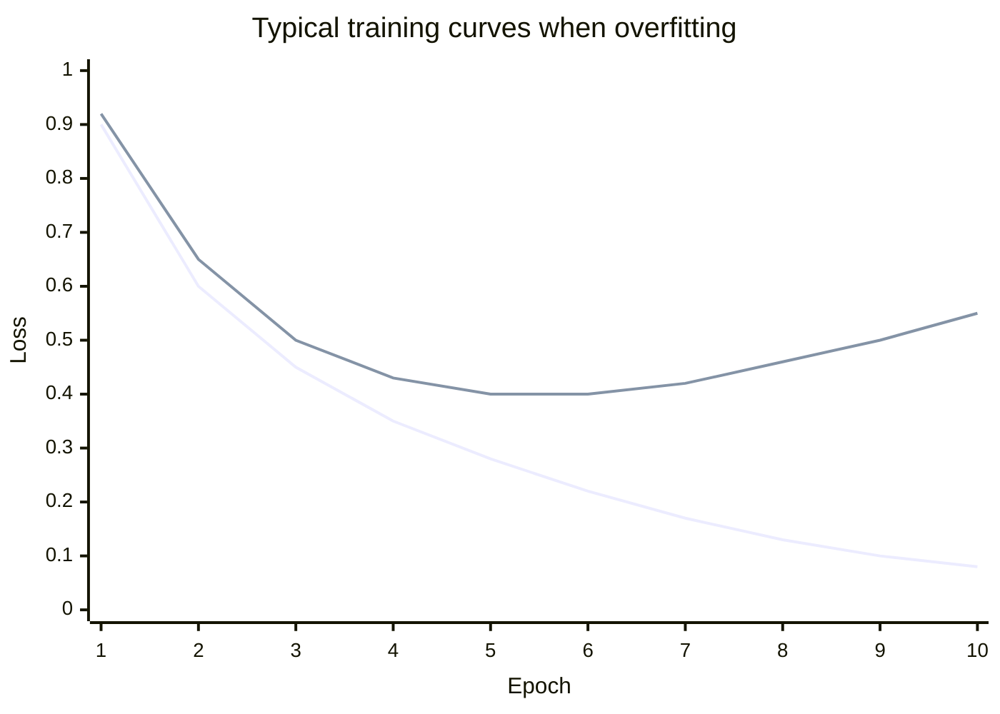

# Overfitting and generalisation

The goal of ML is not to do well on the training data. It's to do well on data the model has never seen. This page is about the gap between those two.

## Underfitting and overfitting

- **Underfitting:** the model is too simple to capture the pattern. Training error and validation error are both high. Example: a straight line fit to a curve.
- **Overfitting:** the model is so flexible it memorises the training data, including its noise. Training error is low but validation error is high. Example: a degree-20 polynomial threading through every point.
- **Good fit:** both errors are low and close together.



The lower line is training loss, which keeps falling. The upper line is validation loss, which falls, bottoms out, then rises. The bottom of the validation curve is where you'd want to stop.

## The bias-variance trade-off

The classical way to think about this:

- **Bias** is error from wrong assumptions (a line can't fit a curve). Simple models have high bias.
- **Variance** is error from being too sensitive to the specific training sample. Flexible models have high variance.

Making a model more flexible reduces bias but increases variance. The sweet spot is in the middle.

:::note
Modern deep learning complicates this picture. Very large networks trained on lots of data often generalise *better* as they get bigger, a phenomenon studied under the name "double descent". The trade-off is still a useful mental model for small models and small data.
:::

## How to fight overfitting

1. **More data.** The single most reliable fix.
2. **Simpler model.** Fewer parameters, shallower trees.
3. **Regularisation.** Add a penalty for large weights to the loss. **L2 regularisation** (also called *weight decay*) adds $\lambda \sum_j w_j^2$, nudging weights towards zero.
4. **Early stopping.** Track validation loss and stop when it stops improving.
5. **Data augmentation.** Create variations of training examples (flip, crop or rotate images; paraphrase text).
6. **Dropout** (for neural networks): randomly switch off neurons during training. See [Regularisation](../neural-networks/regularisation.md).

## Cross-validation

With small datasets, a single validation split is noisy. **k-fold cross-validation** splits the training data into $k$ parts, trains $k$ times using each part once as validation, and averages the scores. It's standard for classical ML; it's usually too expensive for deep learning.

```python
from sklearn.model_selection import cross_val_score
scores = cross_val_score(model, X, y, cv=5)
print(scores.mean(), scores.std())
```

:::tip Try it
Generate 30 noisy points from $y = \sin(x)$. Fit polynomials of degree 1, 3, 9 and 20 with `numpy.polyfit`, and plot each against the data. Then generate 1,000 fresh points and compute the error of each fit on them. Which degree wins? Now add L2 regularisation (`sklearn.linear_model.Ridge` with polynomial features) to the degree-20 model and see what happens.
:::
