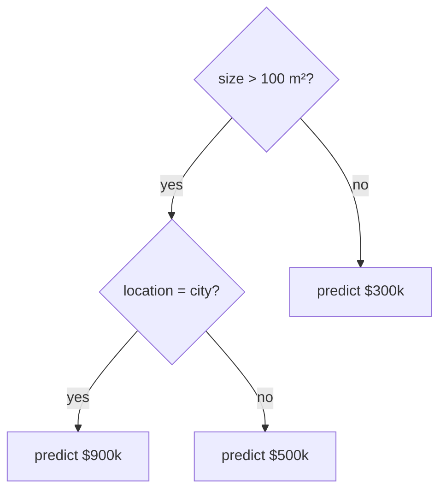

# Decision trees and ensembles

Not all ML uses gradient descent. Decision trees are a completely different approach, and for tabular data (spreadsheets, databases) tree ensembles are still often the best tool available, beating neural networks.

## Decision trees

A decision tree is a flowchart of yes/no questions learned from data:



The learning algorithm builds the tree greedily: at each node, try every feature and every split point, and pick the split that makes the two resulting groups as "pure" as possible (lowest variance for regression, lowest impurity for classification). Repeat on each side until a stopping rule kicks in.

**Strengths:** handle mixed feature types, need no normalisation, easy to interpret.
**Weakness:** a single deep tree memorises its training data and generalises badly.

## Ensembles: many trees beat one

**Random forests** train hundreds of trees, each on a random sample of the data and a random subset of features, then average their predictions. Each tree is overconfident in its own way, and averaging cancels much of that out.

**Gradient boosting** (XGBoost, LightGBM, CatBoost) trains trees one after another, each new tree trying to fix the errors of the ones before it. It's usually the strongest model for tabular data and wins a large share of Kaggle competitions on such data.

```python
from sklearn.ensemble import RandomForestClassifier, HistGradientBoostingClassifier

rf = RandomForestClassifier(n_estimators=300).fit(X_train, y_train)
gb = HistGradientBoostingClassifier().fit(X_train, y_train)
print(rf.score(X_val, y_val), gb.score(X_val, y_val))
```

## When to use what

| Data | Usually best first try |
| --- | --- |
| Tabular, under ~1M rows | Gradient boosted trees |
| Images, audio, video | Neural networks (CNNs, transformers) |
| Text | Pre-trained transformers |
| Very small datasets | Linear models or small trees |

:::info[Key idea]
Deep learning isn't always the answer. For a spreadsheet, try gradient boosting before reaching for a neural network.
:::

:::tip[Try it]
On the same dataset you used for logistic regression, compare logistic regression, a single decision tree (try `max_depth` of 2, 5 and unlimited), a random forest and gradient boosting. Record train and validation accuracy for each in a table. Which one overfits the most?
:::

## Check your understanding

<MultipleChoice
  id="trees-1"
  question="Your data is a spreadsheet of 50,000 customer records with mixed numeric and category columns. What's the best first model to try?"
  options={["A large transformer", "A CNN", "Gradient boosted trees (e.g. LightGBM or HistGradientBoosting)", "k-means clustering"]}
  answer={2}
  explanation="For tabular data under about a million rows, gradient boosting is usually the strongest first try, and it needs no normalisation."
/>

<MultipleChoice
  id="trees-2"
  question="How does gradient boosting differ from a random forest?"
  options={[
    "Boosting trains trees one after another, each fixing the previous trees' errors; a forest trains independent trees and averages them",
    "Boosting uses only one tree",
    "A random forest trains trees in sequence; boosting averages them",
    "There is no difference",
  ]}
  answer={0}
  explanation="Forests reduce variance by averaging many independent, randomised trees. Boosting builds an accurate model step by step from many small corrections."
/>

<MultipleChoice
  id="trees-3"
  question="A single decision tree with unlimited depth gets 100% training accuracy and 70% validation accuracy. What's going on?"
  options={["Underfitting", "Overfitting: the tree has memorised the training data", "A bug in the validation set", "The tree needs feature normalisation"]}
  answer={1}
  explanation="Unlimited depth lets the tree carve out a leaf for almost every training example. Limit max_depth, or use an ensemble."
/>

<OpenQuestion
  id="trees-4"
  question="Why does averaging many trees (a random forest) generalise better than one deep tree?">

Each deep tree overfits, but in a *different* way, because each one sees a different random sample of the rows and a different random subset of features at each split. One tree's mistakes are mostly noise specific to its own sample. When you average hundreds of them, those individual mistakes tend to cancel out, while the real pattern, which all the trees pick up, remains.

In bias-variance terms: each tree has low bias but high variance, and averaging many roughly independent models reduces the variance without adding much bias.

</OpenQuestion>
