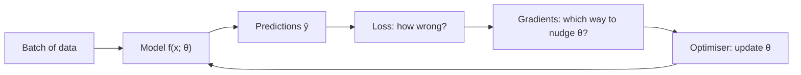

# The core loop: model, loss, optimiser

Every model in this course, from a straight line to a 70B-parameter LLM, is trained with the same loop. If you understand this page, you understand the skeleton of all of machine learning.



## 1. The model

A function with parameters $\theta$. For now, a straight line: $\hat{y} = w x + b$.

## 2. The loss

A single number that says how wrong the model is on the data. Lower is better. For regression, the standard choice is **mean squared error (MSE)**:

$$
L(\theta) = \frac{1}{N} \sum_{i=1}^{N} \left(\hat{y}_i - y_i\right)^2
$$

In words: for each of the $N$ examples, take the difference between prediction and truth, square it (so negatives don't cancel positives, and big errors hurt more), and average.

The loss turns "make the model good" into a precise goal: **find $\theta$ that minimises $L$.**

## 3. The gradient

How do you know which way to change $w$ and $b$? Calculus gives a direct answer. The **gradient** $\nabla_\theta L$ is a vector of partial derivatives: for each parameter, how much the loss changes if you increase that parameter a tiny bit.

- If $\frac{\partial L}{\partial w}$ is positive, increasing $w$ increases the loss, so you should *decrease* $w$.
- If it's negative, you should *increase* $w$.

The gradient points uphill. You want to go downhill.

For our line with MSE loss, the gradients are:

$$
\frac{\partial L}{\partial w} = \frac{2}{N}\sum_i (\hat{y}_i - y_i)\,x_i
\qquad
\frac{\partial L}{\partial b} = \frac{2}{N}\sum_i (\hat{y}_i - y_i)
$$

You don't need to derive these by hand for real models. Frameworks like PyTorch compute gradients automatically (that's what "autograd" means). But doing it once by hand makes the magic go away.

## 4. The optimiser: gradient descent

Take a small step in the downhill direction:

$$
\theta \leftarrow \theta - \eta \, \nabla_\theta L
$$

$\eta$ (eta) is the **learning rate**: how big a step to take.

- Too small and training takes forever.
- Too large and you overshoot the minimum and the loss bounces around or explodes.

Picture standing on a foggy hillside. You can't see the valley, but you can feel the slope under your feet. Take a step downhill, feel again, repeat.

## 5. Repeat

One pass through the whole dataset is an **epoch**. In practice you compute the loss on a small random **batch** of examples rather than the full dataset each step. This is **stochastic gradient descent (SGD)**: noisier, but far cheaper per step, and the noise even helps.

## The whole thing in plain Python

No libraries. Read it, then type it out yourself.

```python
import random

# Fake data: y = 3x + 2, plus noise
xs = [random.uniform(-1, 1) for _ in range(100)]
ys = [3 * x + 2 + random.gauss(0, 0.1) for x in xs]

w, b = 0.0, 0.0       # parameters, start anywhere
lr = 0.1              # learning rate

for step in range(200):
    # forward pass: predictions and loss
    preds = [w * x + b for x in xs]
    loss = sum((p - y) ** 2 for p, y in zip(preds, ys)) / len(xs)

    # backward pass: gradients (from the formulas above)
    dw = sum(2 * (p - y) * x for p, y, x in zip(preds, ys, xs)) / len(xs)
    db = sum(2 * (p - y) for p, y in zip(preds, ys)) / len(xs)

    # update
    w -= lr * dw
    b -= lr * db

    if step % 20 == 0:
        print(f"step {step:3d}  loss {loss:.4f}  w {w:.3f}  b {b:.3f}")
```

You should see `w` approach 3 and `b` approach 2. The algorithm *discovered* the rule that generated the data.

## The same loop, everywhere

Here's the PyTorch version of the same loop. You'll see this shape again and again:

```python
for x, y in dataloader:
    pred = model(x)            # 1. model
    loss = loss_fn(pred, y)    # 2. loss
    optimizer.zero_grad()
    loss.backward()            # 3. gradients (autograd)
    optimizer.step()           # 4. update
```

Training GPT is this loop with a much bigger `model`, a lot more `dataloader`, and a lot more GPUs.

:::info Key idea
Model makes a prediction. Loss measures the error. Gradients say which way to change each parameter. The optimiser takes a small step. Repeat thousands of times.
:::

:::tip Try it
Create `notebooks/01-foundations/gradient-descent.ipynb`. Run the code above, then:

1. Plot the loss over steps (use `matplotlib`).
2. Try learning rates 0.001, 0.1, 1.0 and 1.5. What happens to the loss in each case?
3. Change the data to $y = x^2$. Can a straight line fit it? What does the final loss tell you?
:::
