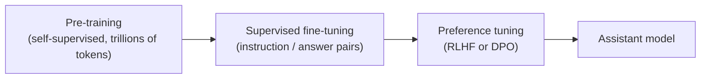

# Types of learning

ML problems are usually grouped by **what kind of feedback** the learning algorithm gets.

## Supervised learning

You have inputs **and** the correct outputs (called *labels*). The model learns to map one to the other.

| Task | Input | Label |
| --- | --- | --- |
| Spam filter | Email text | spam / not spam |
| House prices | Size, location, rooms | Price |
| Image classification | Pixels | "cat", "dog", ... |
| Translation | English sentence | French sentence |

Supervised problems come in two main flavours:

- **Regression**: the output is a number (price, temperature).
- **Classification**: the output is a category (spam or not, which digit).

Most of this course is supervised learning, because it's the clearest place to learn the core ideas.

## Unsupervised learning

You have inputs but **no labels**. The goal is to find structure.

- **Clustering**: group similar customers together.
- **Dimensionality reduction**: compress 1,000 features into 2 so you can plot them.
- **Density estimation**: learn what "normal" data looks like so you can spot anomalies.

## Self-supervised learning (how LLMs are trained)

This is the trick behind modern AI. You take unlabelled data and **create labels from the data itself**.

For text, hide the next word and ask the model to predict it:

```text
Input:  "The cat sat on the"
Label:  "mat"
```

Every sentence on the internet becomes thousands of free training examples. No human had to label anything. This is called **pre-training**, and it's how GPT, Llama and friends learn language. It's technically supervised learning (there's a target), but the targets come for free.

Images work the same way: hide part of a picture and predict the missing patch.

## Reinforcement learning

An **agent** takes actions in an **environment** and gets **rewards**. There's no "correct answer" for each step, only a score that arrives, often much later.

- Game-playing (AlphaGo, Atari agents).
- Robotics.
- **RLHF** (reinforcement learning from human feedback): one of the steps that turns a raw pre-trained LLM into a helpful assistant.

RL is powerful but harder to get working, and it's a later topic. This course touches on it only where it relates to LLMs.

## How a modern chat model is built

Putting these together, a typical assistant LLM goes through:



1. **Pre-training** produces a *base model* that is very good at continuing text, but not at following instructions.
2. **Supervised fine-tuning (SFT)** teaches it the format of being an assistant using example conversations.
3. **Preference tuning** nudges it towards answers humans prefer.

When you fine-tune an open-source model in Part 6, you'll be doing step 2 (and optionally 3), starting from someone else's step 1. Step 1 is the part that costs millions of dollars.

:::info Key idea
Supervised = learn from labelled examples. Self-supervised = make labels out of the data itself. That second idea is what made LLMs possible.
:::
