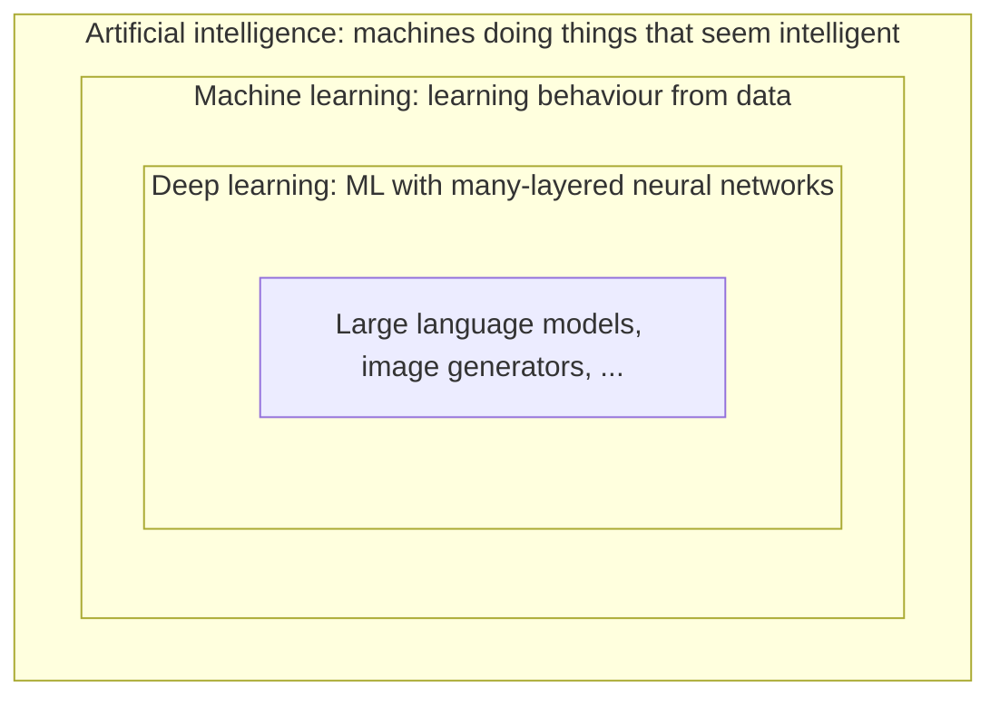

# What is machine learning?

## Traditional programming vs machine learning

In traditional programming you write the rules:

```text
rules + data  →  program  →  answers
```

To detect spam you might write `if "free money" in email: return SPAM`. This works until spammers change their wording, and then you write more rules, forever.

In machine learning you flip it around. You provide examples of inputs **and** the answers you want, and an algorithm finds the rules:

```text
data + answers  →  learning algorithm  →  rules (a model)
```

The "rules" it finds are not readable `if` statements. They're a big pile of numbers inside a mathematical function. But they work on emails the model has never seen, which is the whole point.

## A model is just a function

At its core, a **model** is a function $f$ that maps an input $x$ to an output $\hat{y}$ (read "y-hat", the prediction):

$$
\hat{y} = f(x; \theta)
$$

- $x$ is the input: an email, an image, a row in a spreadsheet, a sequence of words.
- $\theta$ (theta) are the **parameters**: the adjustable numbers inside the function.
- $\hat{y}$ is the output: "spam / not spam", "cat", a house price, the next word.

**Learning** means finding values of $\theta$ that make $f$ produce good outputs. That's it. A linear regression has two parameters. GPT-4-class models have hundreds of billions. The idea is the same.

:::info[Key idea]
Machine learning = choose a flexible family of functions, then use data to pick the member of that family that works best.
:::

## A tiny example

Suppose you have data on house sizes and prices, and you guess that price is roughly a straight line in size:

$$
\text{price} = w \cdot \text{size} + b
$$

Here $\theta = (w, b)$: a slope and an intercept. Different values of $w$ and $b$ give different lines. "Training" is searching for the $w$ and $b$ whose line best fits the data. You'll do exactly this, in code, in [The core loop](./the-core-loop.md).

## Why does this work at all?

Because the world has patterns, and a function with enough flexibility can capture them. But there's a catch: you want the model to capture the *real* pattern, not memorise the quirks of your particular examples. A model that memorises does great on its training data and badly on anything new. This tension, between fitting the data and **generalising** to new data, is the central problem of ML, and it comes up in every part of this course.

## Where AI, ML and deep learning fit



- **AI** is the broad goal. It includes old-school approaches like hand-written expert systems and search algorithms (chess engines).
- **ML** is the approach that has won most of AI: learn from data.
- **Deep learning** is ML using neural networks with many layers. It dominates anything involving images, audio and language.
- **LLMs** (large language models) like GPT, Llama and Claude are deep learning models trained to predict the next piece of text, at enormous scale.

## What you should take away

1. A model is a function with adjustable parameters.
2. Training means adjusting those parameters to fit example data.
3. The goal is not to fit the training data perfectly, but to do well on data you haven't seen.

## Spotting a problem that suits ML

A useful rule of thumb:

:::info[Rule of thumb]
ML is a good fit when the rule is **hard to write down** but **examples are easy to collect**.
:::

You can't write an `if` statement that says which emails are important to you, but you already have years of emails and you know which ones you replied to. That combination (no clear rule, plenty of examples) is exactly where a learned function shines.

When looking for problems, ask:

1. **Is there a decision or a guess I make repeatedly?** Sorting, prioritising, estimating, spotting something odd.
2. **Could I describe it as input → output?** The input is what you look at; the output is what you decide.
3. **Do I have a record of past inputs and what the answer turned out to be?** Logs, history, spreadsheets, exports. Often the labels already exist because they're a side effect of something you did anyway.

## Worked examples

Here are five examples written out in full, the way you'll write your own. Some are personal, some are software-engineering problems.

### 1. Email triage

- **Input $x$:** an incoming email: sender, subject, body text, whether you're in To or CC, time sent.
- **Output $y$:** a category such as *reply today*, *read later*, *newsletter* or *ignore*. This is **classification**.
- **Where the data comes from:** your existing mailbox. You don't need to label anything by hand: emails you replied to within a few hours are *reply today*, ones you archived unread are *ignore*, ones from senders with an unsubscribe link are probably *newsletter*.
- **Why not just write rules?** You could write `if sender == boss`, but what makes an email urgent is subtle and changes over time. Your past behaviour captures it better.

### 2. Commute time

- **Input $x$:** departure time, day of the week, weather (rain or not), route, whether it's school holidays.
- **Output $y$:** how many minutes the trip will take. This is **regression** (the output is a number).
- **Where the data comes from:** log each trip for a few weeks (a phone shortcut that records start and end times), or export your phone's location history. Weather history is freely available online.
- **What you'd learn:** which features actually matter. Maybe rain adds 12 minutes and Fridays are 8 minutes faster.

### 3. Flaky CI tests

- **Input $x$:** a failed test run: the test's name, its pass/fail history over the last 50 runs, how much its duration varies, which files the commit changed, which CI runner it ran on.
- **Output $y$:** was this failure **flaky** (a random failure unrelated to the change) or **real**? Binary classification.
- **Where the data comes from:** your CI history. Every time a failed job was re-run on the *same commit* and passed, you have a free "flaky" label. Failures fixed by a follow-up commit are "real".
- **Why it's useful:** auto-retry or quarantine likely-flaky failures, and flag real ones loudly.

### 4. Expense categorisation

- **Input $x$:** a bank transaction: merchant description text (for example `SQ *BLUE BOTTLE 0423`), amount, date, day of the week.
- **Output $y$:** a category such as groceries, eating out, transport or subscriptions. Classification.
- **Where the data comes from:** bank CSV exports from months you've already categorised, in a spreadsheet or a budgeting app.
- **Why not rules?** Merchant strings are messy and endlessly varied. A model learns that `SQ *` plus a café-sounding word usually means eating out.

### 5. Incident detection from metrics

- **Input $x$:** the last 30 minutes of service metrics: request latency (p50 and p99), error rate, CPU, memory, queue depth.
- **Output $y$:** will there be an incident in the next 15 minutes? Binary classification. Alternatively, an "unusualness" score, which is **unsupervised** anomaly detection and needs no labels at all.
- **Where the data comes from:** your monitoring system's history (Prometheus, Datadog, CloudWatch) joined with your incident log's timestamps.
- **Watch out for:** incidents are rare, so "never predict an incident" scores 99.9% accuracy and is useless. This is the class-imbalance problem from [Evaluating models](../classical-ml/evaluation.md).

### Non-examples: when ML is the wrong tool

- **Calculating tax, converting units, sorting a list.** The rule is known exactly. Write the code.
- **Predicting the lottery.** There's no pattern to learn.
- **Something you've only done three times.** Not enough examples. Write a rule, or wait until you have data.

## A template for your own

```text
Problem:      <what decision or guess do I make repeatedly?>
Input x:      <what information do I look at when I decide?>
Output y:     <what do I decide? a category, a number, a yes/no?>
Data source:  <where are past examples, and where do the answers (labels) come from?>
Type:         <classification / regression / unsupervised>
Baseline:     <what simple rule would I compare against?>
```

:::tip[Try it]
Before going further, write down in `notes/` three problems from your own life or work where you'd *want* a learned function, using the template above. It's fine to adapt one of the worked examples to your own situation; the point is to practise seeing problems as "input → output, learned from examples". You'll revisit this list later.
:::
