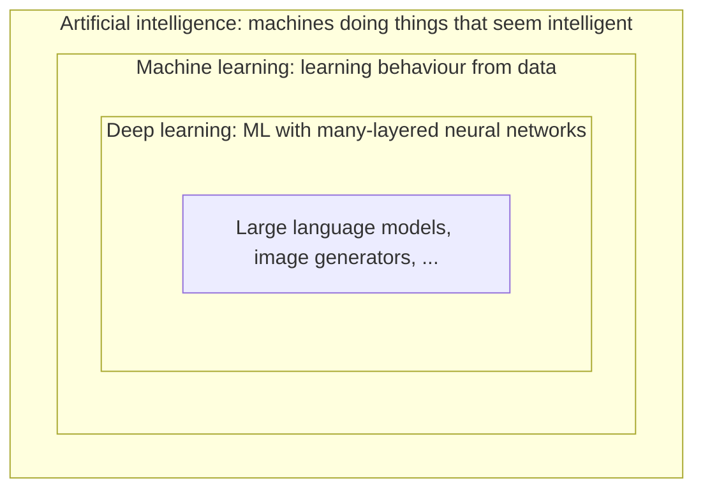

# What is machine learning?

## Traditional programming vs machine learning

In traditional programming you write the rules:

```text
rules + data  →  program  →  answers
```

To detect spam you might write `if "free money" in email: return SPAM`. This works until spammers change their wording, and then you write more rules, forever.

In machine learning you flip it around. You provide examples of inputs **and** the answers you want, and an algorithm finds the rules:

```text
data + answers  →  learning algorithm  →  rules (a model)
```

The "rules" it finds are not readable `if` statements. They're a big pile of numbers inside a mathematical function. But they work on emails the model has never seen, which is the whole point.

## A model is just a function

At its core, a **model** is a function $f$ that maps an input $x$ to an output $\hat{y}$ (read "y-hat", the prediction):

$$
\hat{y} = f(x; \theta)
$$

- $x$ is the input: an email, an image, a row in a spreadsheet, a sequence of words.
- $\theta$ (theta) are the **parameters**: the adjustable numbers inside the function.
- $\hat{y}$ is the output: "spam / not spam", "cat", a house price, the next word.

**Learning** means finding values of $\theta$ that make $f$ produce good outputs. That's it. A linear regression has two parameters. GPT-4-class models have hundreds of billions. The idea is the same.

:::info Key idea
Machine learning = choose a flexible family of functions, then use data to pick the member of that family that works best.
:::

## A tiny example

Suppose you have data on house sizes and prices, and you guess that price is roughly a straight line in size:

$$
\text{price} = w \cdot \text{size} + b
$$

Here $\theta = (w, b)$: a slope and an intercept. Different values of $w$ and $b$ give different lines. "Training" is searching for the $w$ and $b$ whose line best fits the data. You'll do exactly this, in code, in [The core loop](./the-core-loop.md).

## Why does this work at all?

Because the world has patterns, and a function with enough flexibility can capture them. But there's a catch: you want the model to capture the *real* pattern, not memorise the quirks of your particular examples. A model that memorises does great on its training data and badly on anything new. This tension, between fitting the data and **generalising** to new data, is the central problem of ML, and it comes up in every part of this course.

## Where AI, ML and deep learning fit



- **AI** is the broad goal. It includes old-school approaches like hand-written expert systems and search algorithms (chess engines).
- **ML** is the approach that has won most of AI: learn from data.
- **Deep learning** is ML using neural networks with many layers. It dominates anything involving images, audio and language.
- **LLMs** (large language models) like GPT, Llama and Claude are deep learning models trained to predict the next piece of text, at enormous scale.

## What you should take away

1. A model is a function with adjustable parameters.
2. Training means adjusting those parameters to fit example data.
3. The goal is not to fit the training data perfectly, but to do well on data you haven't seen.

:::tip Try it
Before going further, write down in `notes/` three problems from your own life or work where you'd *want* a learned function. For each one: what's the input $x$, what's the output $y$, and where would the example data come from? You'll revisit this list later.
:::
