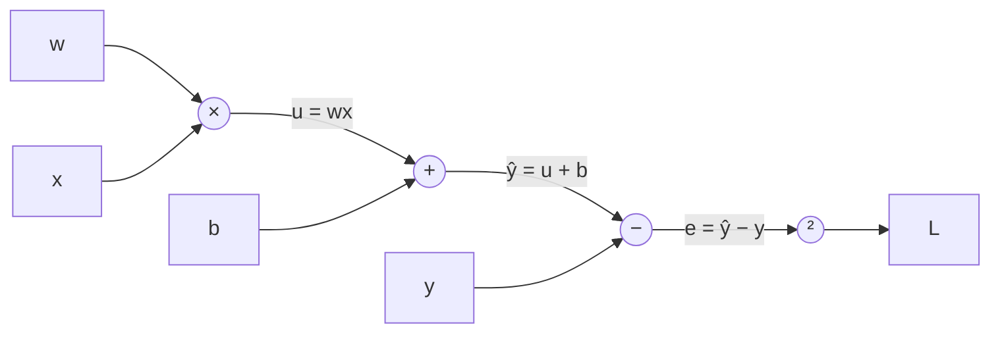

# Backpropagation

We know how to train a model if we have the gradient of the loss with respect to every parameter. A network might have millions of parameters, so how do we get millions of gradients efficiently? **Backpropagation**: the chain rule, applied backwards through the network, reusing work as it goes.

## A computation graph

Any calculation can be drawn as a graph of simple operations. Take $L = (wx + b - y)^2$:



## Forward pass

Plug in numbers: $w = 2, x = 3, b = 1, y = 10$.

- $u = wx = 6$
- $\hat{y} = u + b = 7$
- $e = \hat{y} - y = -3$
- $L = e^2 = 9$

## Backward pass

Now walk backwards, computing how much $L$ changes with respect to each intermediate value. Each step only needs the *local* derivative of one simple operation, multiplied by the gradient flowing in from above (the chain rule).

- $\frac{\partial L}{\partial e} = 2e = -6$
- $\frac{\partial L}{\partial \hat{y}} = \frac{\partial L}{\partial e}\cdot 1 = -6$
- $\frac{\partial L}{\partial b} = \frac{\partial L}{\partial \hat{y}} \cdot 1 = -6$
- $\frac{\partial L}{\partial u} = \frac{\partial L}{\partial \hat{y}} \cdot 1 = -6$
- $\frac{\partial L}{\partial w} = \frac{\partial L}{\partial u}\cdot x = -18$

Both gradients are negative, so increasing $w$ and $b$ would reduce the loss. Correct: the prediction (7) is too low.

## Why it's efficient

Each gradient reuses the one computed just above it. Computing all gradients costs roughly the same as one or two forward passes, no matter how many parameters there are. Without this trick, deep learning would be computationally impossible.

The cost: the backward pass needs the intermediate values from the forward pass ($x$, $u$, $e$ and so on), so they must be kept in memory. These are called **activations**, and storing them is a major part of GPU memory use during training. It's why training needs much more VRAM than inference, as you'll see in the [VRAM maths](../hardware/vram-math.md).

## Autograd does this for you

In PyTorch, any tensor with `requires_grad=True` records the operations applied to it. Calling `.backward()` runs backpropagation through that record.

```python
import torch

w = torch.tensor(2.0, requires_grad=True)
b = torch.tensor(1.0, requires_grad=True)
x, y = torch.tensor(3.0), torch.tensor(10.0)

L = (w * x + b - y) ** 2
L.backward()

print(w.grad, b.grad)   # tensor(-18.) tensor(-6.)
```

Same numbers as the hand calculation.

## Problems that show up in deep networks

- **Vanishing gradients:** multiplying many small local derivatives together gives a gradient near zero, so early layers barely learn. Fixes: ReLU-family activations, careful initialisation, normalisation layers, residual connections.
- **Exploding gradients:** multiplying many large derivatives gives enormous gradients and the loss goes to `NaN`. Fix: **gradient clipping** (cap the gradient's size), plus the same fixes as above.

:::info[Key idea]
Backpropagation is the chain rule run backwards through a computation graph. It gets every gradient for about the cost of one extra forward pass, at the price of storing intermediate activations in memory.
:::

:::tip[Try it]
Watch Andrej Karpathy's ["The spelled-out intro to neural networks and backpropagation: building micrograd"](https://www.youtube.com/watch?v=VMj-3S1tku0) (about 2.5 hours, embedded [below](#watch)) and build micrograd alongside him in `notebooks/03-neural-networks/micrograd.ipynb`. It's the single best exercise for understanding backprop. Afterwards, check your gradients match PyTorch's on a few expressions.
:::

## Watch

Optional videos that explain this lesson's ideas another way. Click a thumbnail to play it here, or the title to open it on YouTube.

<YouTube id="Ilg3gGewQ5U" title="Backpropagation, intuitively | Deep Learning Chapter 3" channel="3Blue1Brown">

The intuition first: how each weight's gradient says how much it should change, with no heavy maths.

</YouTube>

<YouTube id="tIeHLnjs5U8" title="Backpropagation calculus | Deep Learning Chapter 4" channel="3Blue1Brown">

The same chain-rule calculation as the worked example above, drawn out visually.

</YouTube>

<YouTube id="VMj-3S1tku0" title="The spelled-out intro to neural networks and backpropagation: building micrograd" channel="Andrej Karpathy">

The video for the *Try it* box above. Long, but you'll come out understanding backprop better than most people who use it every day.

</YouTube>

## Check your understanding

<MultipleChoice
  id="backprop-1"
  question="In the worked example, ∂L/∂w = −18. What does the negative sign tell you?"
  options={[
    "Increasing w would reduce the loss",
    "Increasing w would increase the loss",
    "w is already optimal",
    "The loss is negative",
  ]}
  answer={0}
  explanation="A negative gradient means the loss goes down as w goes up. The prediction (7) was too low, so a bigger w helps."
/>

<MultipleChoice
  id="backprop-2"
  question="Why does training use much more GPU memory than inference?"
  options={[
    "Training uses bigger weights",
    "The backward pass needs the intermediate activations from the forward pass, so they must be stored (as well as gradients and optimiser state)",
    "Inference doesn't use the GPU",
    "Training data is stored on the GPU",
  ]}
  answer={1}
  explanation="Every intermediate value is kept for backprop. Inference can throw them away as soon as the next layer has used them."
/>

<MultipleChoice
  id="backprop-3"
  question="Your loss suddenly becomes NaN after the gradients grow enormous. What's the standard fix?"
  options={["Gradient clipping", "Removing the bias terms", "Using sigmoid activations everywhere", "Training on the test set"]}
  answer={0}
  explanation="Clipping caps the size of the gradient so one bad step can't blow up the parameters. Lowering the learning rate also helps."
/>

<OpenQuestion
  id="backprop-4"
  question="Redo the worked example with w = 1, x = 2, b = 0, y = 5. Compute the forward pass, then ∂L/∂w and ∂L/∂b. Which way should w move?">

Forward pass:

- u = w·x = 1 × 2 = 2
- ŷ = u + b = 2 + 0 = 2
- e = ŷ − y = 2 − 5 = −3
- L = e² = 9

Backward pass:

- ∂L/∂e = 2e = −6
- ∂L/∂ŷ = −6 × 1 = −6
- ∂L/∂b = −6 × 1 = **−6**
- ∂L/∂u = −6 × 1 = −6
- ∂L/∂w = ∂L/∂u × x = −6 × 2 = **−12**

Both are negative, so **increase** w and b. That makes sense: the prediction (2) is below the target (5).

You can check it in PyTorch:

```python
import torch
w = torch.tensor(1.0, requires_grad=True)
b = torch.tensor(0.0, requires_grad=True)
L = (w * 2.0 + b - 5.0) ** 2
L.backward()
print(w.grad, b.grad)   # tensor(-12.) tensor(-6.)
```

</OpenQuestion>
