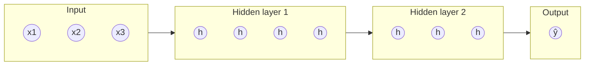

# Neurons, layers and activations

## A neuron is logistic regression

An artificial **neuron** takes some inputs, computes a weighted sum plus a bias, and passes the result through a non-linear **activation function**:

$$
a = \phi(w \cdot x + b)
$$

If $\phi$ is the sigmoid, a single neuron *is* logistic regression. Nothing mysterious so far. The name comes from a loose analogy with brain cells; don't read too much into it.

## Layers: many neurons side by side

Put many neurons next to each other, all reading the same input, and you get a **layer**. Each neuron has its own weights, so stack them as rows of a matrix:

$$
h = \phi(W x + b)
$$

With 784 inputs (a 28×28 image) and 128 neurons, $W$ has shape $(128, 784)$: about 100,000 parameters in one layer.

## Networks: layers stacked up

Feed the output of one layer into the next and you have a **multi-layer perceptron (MLP)**, the simplest neural network:

$$
\begin{aligned}
h_1 &= \phi(W_1 x + b_1) \\
h_2 &= \phi(W_2 h_1 + b_2) \\
\hat{y} &= W_3 h_2 + b_3
\end{aligned}
$$

The middle layers are called **hidden layers**. "Deep" learning just means many of them.

## Why the activation function matters

Without $\phi$, stacking layers is pointless: $W_2 (W_1 x)$ is just $(W_2 W_1) x$, another single linear layer. The non-linearity is what lets the network bend and fold the input space, so it can represent curved decision boundaries and complex functions.

In fact, the **universal approximation theorem** says an MLP with a single, wide enough hidden layer can approximate any continuous function as closely as you like. Depth makes this far more efficient in practice.

## Common activation functions

| Name | Formula | Where it's used |
| --- | --- | --- |
| Sigmoid | $\frac{1}{1+e^{-z}}$ | Output of binary classifiers. Rarely in hidden layers now. |
| Tanh | $\tanh(z)$ | Older RNNs. Output in (-1, 1). |
| **ReLU** | $\max(0, z)$ | The default for hidden layers. Cheap, works well. |
| GELU / SiLU | smooth versions of ReLU | Transformers and modern LLMs. |

Sigmoid and tanh **saturate**: for large inputs their slope is nearly zero, so gradients vanish and deep networks stop learning. ReLU's slope is exactly 1 for positive inputs, which is a big part of why deep networks became trainable around 2012.

## What the layers learn

Each layer transforms its input into a new representation. In an image network, early layers learn edges, middle layers learn textures and parts, later layers learn whole objects. Nobody programs this; it emerges from minimising the loss. This is the key difference from classical ML: **the network learns its own features.**

:::info Key idea
A neural network is layers of "linear transform, then non-linearity", stacked. The non-linearity is what makes depth useful.
:::

:::tip Try it
Go to the [TensorFlow Playground](https://playground.tensorflow.org/) in your browser. Pick the spiral dataset. Try to classify it with no hidden layers, then one, then several. Swap ReLU for linear activation and watch it fail. Fifteen minutes here builds more intuition than an hour of reading.
:::
