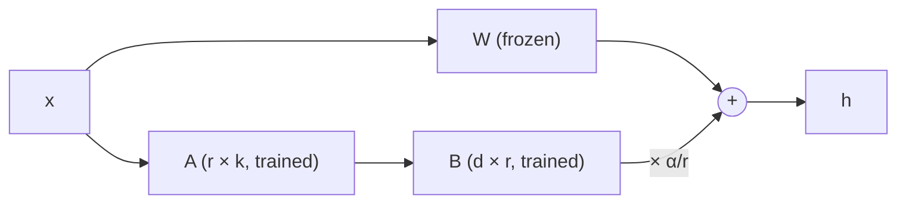

# LoRA and QLoRA

LoRA is the technique that makes fine-tuning large models possible on hardware like yours. QLoRA combines it with 4-bit quantisation to stretch it even further.

## LoRA: Low-Rank Adaptation

A weight matrix $W$ in a transformer might be $4096 \times 4096$: about 16.8 million numbers. Full fine-tuning learns an update $\Delta W$ of the same size.

The LoRA insight (Hu et al., 2021): the update needed for fine-tuning is usually **low-rank**. It can be well approximated as the product of two thin matrices:

$$
\Delta W = B A, \qquad B \in \mathbb{R}^{d \times r},\; A \in \mathbb{R}^{r \times k},\; r \ll d
$$

With rank $r = 16$, $B$ and $A$ together have $4096 \times 16 + 16 \times 4096 \approx 131{,}000$ numbers. That's **under 1%** of the full matrix.

The layer's output becomes:

$$
h = W x + \frac{\alpha}{r} B A x
$$

- $W$ is **frozen**: no gradients, no optimiser state.
- Only $A$ and $B$ are trained.
- $B$ starts at zero, so at the start of training the model behaves exactly like the original.
- $\alpha$ is a scaling factor that controls how strongly the adapter affects the output.

## Why it saves so much memory

Recall full fine-tuning costs about 16 bytes per parameter. With LoRA, the frozen weights cost just their storage (2 bytes in bf16), and the 16-bytes-per-parameter cost applies only to the tiny adapter. For a 1.5B model:

- Full fine-tune: about 24 GB plus activations. Doesn't fit.
- LoRA: about 3 GB for frozen weights plus a few hundred MB for adapters and optimiser state, plus activations. Fits.

Bonus: the trained adapter is a small file (tens of MB), so you can keep many adapters for one base model and swap them.

## QLoRA: LoRA on a 4-bit base

**QLoRA** (Dettmers et al., 2023) goes one step further: store the frozen base model in **4-bit NF4**, and train 16-bit LoRA adapters on top. Gradients flow *through* the dequantised 4-bit weights into the adapters.

That cuts the frozen weights' cost from 2 bytes to about 0.5 bytes per parameter. For an 8B model: about 5 GB instead of 16 GB, which is what makes 7–8B fine-tuning possible on an 8 GB card (only just; see below).

QLoRA also introduced **paged optimisers**, which move optimiser state to CPU RAM when the GPU runs out, avoiding crashes from memory spikes.

## The knobs

| Hyperparameter | Typical values | Effect |
| --- | --- | --- |
| `r` (rank) | 8–64 | Adapter capacity. 16 is a good default. Higher for bigger behaviour changes. |
| `lora_alpha` | Often `r` or `2r` | Scale of the update. Effective strength is alpha divided by r. |
| `target_modules` | Attention projections (q, k, v, o) or `"all-linear"` | Which layers get adapters. All linear layers usually works best. |
| `lora_dropout` | 0–0.1 | Regularisation on the adapter. |
| Learning rate | 1e-4 to 2e-4 | Higher than full fine-tuning, because adapters start from zero. |
| Epochs | 1–3 | More risks overfitting a small dataset. |

## What fits on an 8 GB NVIDIA card

Approximate, with gradient checkpointing, bf16 compute and batch size 1–2 plus gradient accumulation:

| Base model | Method | Max comfortable sequence length | Verdict |
| --- | --- | --- | --- |
| 0.5–1.5B | LoRA (bf16 base) | 2048+ | Comfortable. Great first project. |
| 3B | QLoRA | 1024–2048 | Comfortable. The sweet spot for real projects. |
| 7–8B | QLoRA | 512–1024 | Tight but works. Expect slow steps and to tune memory carefully. |
| 13B+ | QLoRA | — | Doesn't fit. Rent a GPU. |

**Unsloth** is a library that rewrites the key kernels for LoRA/QLoRA training and typically cuts memory use substantially and roughly doubles speed. On an 8 GB card it can make the difference between a 7–8B run fitting or not. Worth using once you understand the plain `peft` version.

## What fits on an Apple Silicon Mac (48 GB example)

A 48 GB Mac has about 36–40 GB usable by the GPU. Using MLX (`mlx_lm.lora`), roughly (halve the model sizes for a 24 GB Mac):

| Base model | Method | Verdict |
| --- | --- | --- |
| 1.5–3B | LoRA (bf16 base) | Easy, long sequences fine. Good for fast iteration. |
| 7–8B | LoRA (bf16 base) | Comfortable. No quantisation needed. |
| 14B | QLoRA (4-bit base) | Comfortable. |
| 27–32B | QLoRA (4-bit base) | Possible with short sequences and fewer LoRA layers. |
| 70B | — | Doesn't fit. Rent a GPU. |

Steps are slower than on an NVIDIA card of similar size, but a Mac with plenty of memory can fine-tune much larger models than an 8 GB card. A good workflow is to debug your data and settings on a small model on either machine, then do the 7B+ run on the Mac. See [Apple Silicon](../hardware/apple-silicon.md) for the commands.

## After training

You have two choices:

1. **Keep the adapter separate.** Load the base model, then load the adapter on top. Easy to swap adapters.
2. **Merge it in.** Compute $W + \frac{\alpha}{r}BA$ once and save a normal model. No extra inference cost, and you can then convert it to GGUF and run it in Ollama.

:::info[Key idea]
LoRA freezes the big model and trains two small matrices per layer whose product is the update. QLoRA does the same with the frozen model stored in 4-bit. Together they cut fine-tuning memory by around 10× or more.
:::

:::tip[Try it]
Before training anything, calculate on paper: for a 3B model with 28 layers, hidden size 3072, and LoRA rank 16 on just the q and v projections (each $3072 \times 3072$), how many trainable parameters are there? What fraction of the model is that? Then check your answer with `model.print_trainable_parameters()` in the walkthrough on the next page.
:::

## Watch

Optional videos that explain this lesson's ideas another way. Click a thumbnail to play it here, or the title to open it on YouTube.

<YouTube id="t509sv5MT0w" title="LoRA explained (and a bit about precision and quantization)" channel="DeepFindr">

The low-rank trick drawn out with matrices, plus the number formats that make QLoRA possible.

</YouTube>

## Check your understanding

<MultipleChoice
  id="lora-1"
  question="In LoRA, which weights are trained?"
  options={["All of the model's weights", "Only the small matrices A and B added alongside the frozen weights", "Only the embedding layer", "Only the final lm_head"]}
  answer={1}
  explanation="W stays frozen (no gradients, no optimiser state). Only the low-rank adapters A and B are trained."
/>

<MultipleChoice
  id="lora-2"
  question="Why does B start at zero?"
  options={[
    "To save memory",
    "So the adapter adds nothing at first, and the model starts out behaving exactly like the original",
    "Because zero is the only valid value",
    "So the learning rate can be lower",
  ]}
  answer={1}
  explanation="With B = 0, BA = 0, so training starts from the pre-trained model's behaviour and moves away gradually."
/>

<MultipleChoice
  id="lora-3"
  question="What does QLoRA add on top of LoRA?"
  options={[
    "It trains the adapters in 4-bit",
    "It stores the frozen base model in 4-bit (NF4), cutting its memory roughly 4×, while adapters stay 16-bit",
    "It removes the need for a GPU",
    "It merges the adapter automatically",
  ]}
  answer={1}
  explanation="The frozen weights drop from 2 bytes to about 0.5 bytes per parameter. That's what makes 7–8B fine-tuning possible on 8 GB."
/>

<MultipleChoice
  id="lora-4"
  question="What's a typical learning rate for LoRA, and why is it higher than for full fine-tuning?"
  options={["1e-6, to be safe", "1e-4 to 2e-4, because the adapters start from zero and need to move further", "1.0, because adapters are small", "The same as full fine-tuning"]}
  answer={1}
  explanation="Full fine-tuning uses 1e-5 to 5e-5 to avoid wrecking existing knowledge. Adapters start from nothing, so they can take bigger steps."
/>

<OpenQuestion
  id="lora-5"
  question="Do the 'Try it' calculation: a 3B model with 28 layers, LoRA rank 16 on just the q and v projections (each 3072 × 3072). How many trainable parameters is that, and what fraction of the model?">

For one 3072 × 3072 projection with rank 16:

- A is 16 × 3072 = 49,152 numbers
- B is 3072 × 16 = 49,152 numbers
- Total per projection: **98,304**

Two projections (q and v) per layer: 2 × 98,304 = 196,608.

28 layers: 28 × 196,608 = **5,505,024**, about 5.5 million trainable parameters.

As a fraction of a 3B model: 5.5M ÷ 3,000M ≈ **0.18%**.

(In real models like Qwen 2.5, the k and v projections are often smaller than 3072 × 3072 because of grouped-query attention, so `print_trainable_parameters()` may show a somewhat smaller number. The method is the same.)

</OpenQuestion>
