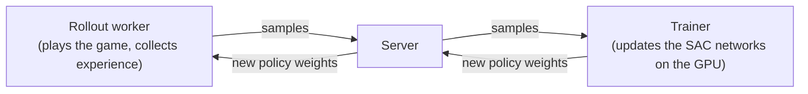

# Capstone: an AI that drives in Trackmania

Teaching an AI to race in Trackmania is a classic hobby RL project, made popular by YouTube videos and by community projects that have produced superhuman runs on some tracks. It's a great capstone because it uses everything in this part (observations, actions, rewards, replay buffers, actor-critic methods) on a real game instead of a toy.

Do this after the [Gymnasium practice](./practice-with-gymnasium.md), especially CarRacing. If you can get CarRacing working, you have the skills for this.

## Two community projects

You don't need to build the plumbing (screen capture, controller input, reward computation) from scratch. Two open-source projects do it for you:

| | **TMRL** | **Linesight** |
| --- | --- | --- |
| Game | TrackMania 2020 (free starter access) | TrackMania Nations Forever (free) |
| Hooks into the game via | OpenPlanet plugin, screen capture, virtual gamepad | TMInterface, a TAS tool for TMNF |
| Algorithm | SAC by default (actor-critic, continuous actions); REDQ also available | IQN (a distributional DQN variant, discrete actions) |
| Speed | Real time: the game can't be sped up | Can run the game faster than real time and in parallel |
| Observations | "LIDAR" distances or raw screenshots, plus speed | Screenshots plus game state |
| Difficulty | Designed to be approachable; good docs; pip-installable | More advanced; aimed at pushing for record times |
| Links | [github.com/trackmania-rl/tmrl](https://github.com/trackmania-rl/tmrl) | [github.com/Linesight-RL/linesight](https://github.com/Linesight-RL/linesight) |

**Recommendation:** start with **TMRL**. It's built as a learning framework, exposes a Gymnasium-style environment, and has a tutorial for plugging in your own algorithm. Move to Linesight later if you get hooked and want to chase fast times.

Both tools change over time. Treat the details below as a map, and follow each project's README for exact commands and versions.

## How TMRL frames the problem

### Observations

TMRL offers several observation modes:

- **LIDAR:** from each screenshot, it measures the distance to the track borders along 19 rays fanning out in front of the car, like a laser scanner. Together with the car's speed and the last few actions, that's a small vector, so a simple MLP policy can learn from it. This is the fastest way to get a working agent, but it needs flat tracks with clear borders.
- **Full images:** a stack of recent downscaled greyscale screenshots plus speed, gear and RPM. Needs a CNN and much more training, but works on more interesting tracks.

### Actions

Three continuous values sent through a virtual gamepad: **gas**, **brake** and **steering**. That's analogue control, which is why TMRL uses SAC rather than DQN.

### Reward

Before training, you **drive the track once yourself**, and TMRL records your trajectory as a line of points. During training, the reward at each step is **how far along that reference line the car has progressed** since the last step. Fast progress earns a big reward, crashing or stopping earns none, and the episode ends at the finish line or when the car gets stuck. This is the same idea as CarRacing's tile reward.

### Time steps and real time

The game runs in real time, and the agent acts at a fixed rate (around 20 times per second). TMRL uses a library called `rtgym` to keep this timing consistent. The consequence is important: **you cannot collect experience faster than the clock**. One hour of training is at most one hour of driving. That's why a sample-efficient, off-policy algorithm like SAC (which reuses every frame many times from its replay buffer) is the right choice.

### Architecture

TMRL splits training into three processes that communicate over the network:

All three can run on one PC. They can also be split: for example, the game and worker on your Windows PC and the trainer on another machine.

## Where it runs: Windows, not WSL

TrackMania 2020 and the TMRL worker need **native Windows**: the worker captures the game window and sends virtual gamepad input, which a WSL Linux environment can't do. So for this capstone:

- Create a **separate native Windows Python environment** with CUDA-enabled PyTorch (see [A native Windows environment](../hardware/setup-windows-wsl.md#a-native-windows-environment-for-trackmania)) and install TMRL there.
- Keep using WSL for everything else in the course. The two environments don't interfere.
- The **Mac can't run TrackMania 2020** natively, so it plays no part here, apart from optionally hosting the trainer.

Any recent NVIDIA GPU with 6 GB or more is plenty. With LIDAR observations the networks are tiny; even with images, the bottleneck is the real-time game, not the GPU. Running the game and the trainer on the same PC is fine. Keep the game window small (TMRL's docs specify a resolution) so screen capture stays cheap.

## Realistic expectations

- **LIDAR agent on a simple flat track:** expect it to start completing the track after a few hours of training, and to keep improving its lines and speed over a day or so.
- **Image-based agent or a more complex track:** days of training, and more tuning.
- **Beating good human times:** possible on simple tracks with patience. The record-breaking results you may have seen came from long training runs, sped-up simulation (Linesight) and a lot of engineering.
- **Plan for the PC to be busy.** Training means the game is running and driving the whole time. Overnight runs are normal.

Only use your agent offline, on your own or local tracks. Don't use it in online play or competitions.

## A staged plan

### Stage 0: prerequisites

Finish the earlier pages in this part, including SAC on Pendulum and an agent on CarRacing. Read the TMRL README end to end.

### Stage 1: get the pipeline running

1. Install TrackMania 2020 and OpenPlanet on Windows.
2. In a native Windows Python environment: `pip install tmrl`, then follow the README's install step, which sets up the config folder and OpenPlanet plugin.
3. Set up the game window as the docs describe (windowed mode, size, camera, ghost hidden).
4. Use the provided test track and its pre-recorded reward.
5. Run the environment check from the README to confirm screenshots, LIDAR and gamepad control all work.

**Milestone:** you can see the LIDAR readings change as the car moves, and the agent can send inputs to the game.

### Stage 2: train your first agent

1. Start the server, trainer and worker as described in the README.
2. Let it train. Watch the episode return in the logs or TensorBoard, and watch the car.
3. Save checkpoints and keep notes on time trained against track progress.

**Milestone:** the car completes the test track on its own.

### Stage 3: your own track

1. Build a simple flat track with clear borders in the track editor.
2. Drive it yourself to record a new reward trajectory.
3. Train on it from scratch, then try starting from your test-track agent and compare.

**Milestone:** an agent that completes a track you made.

### Stage 4: experiment

Change one thing at a time, and log the results in `notes/rl-log.md`:

- Reward: add a speed bonus or a penalty for steering jitter, and watch for reward hacking.
- Hyperparameters: learning rate, replay buffer size, discount $\gamma$.
- Algorithm: SAC vs REDQ.
- Observation history: how many past frames and actions the policy sees.

### Stage 5: learn from pixels

Switch to full image observations with a CNN policy. Expect much longer training, and use what you learned from CarRacing (frame stacking, greyscale, small images).

### Stage 6 (stretch goals)

- **Bring your own algorithm.** TMRL's tutorial shows how to plug in a custom training algorithm. Implement SAC yourself in PyTorch, or try PPO, and compare it with the built-in one.
- **Try Linesight** on TrackMania Nations Forever, and compare its DQN-family approach (sped-up, parallel, discrete actions) with TMRL's real-time SAC.
- **Write it up** in `projects/trackmania/` with videos, learning curves and what worked. It makes a great portfolio piece.

:::info[Key idea]
Trackmania is CarRacing with real-world constraints: a real game, real time and a reward you record yourself. The concepts are the same: observations, actions, a progress-based reward and an off-policy actor-critic that makes the most of every frame.
:::
