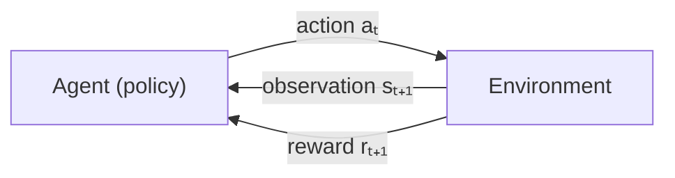

# How reinforcement learning works

Everything so far has been **supervised**: someone (or the data itself) tells the model the right answer for every example. Reinforcement learning (RL) is different. There is no right answer for each step, only a **reward** signal that says how well things are going, often long after the decision that mattered.

That's the situation in a racing game. Nobody can tell you the "correct" steering angle at every frame. But you can tell whether the car is making progress around the track, and whether it crashed.

## The loop

At each time step $t$:

1. The agent sees an **observation** (or **state**) $s_t$: game pixels, the car's speed, distances to the track walls.
2. It picks an **action** $a_t$: steer left, accelerate, brake.
3. The environment moves forward one step and returns a **reward** $r_{t+1}$ and the next observation.

One run from start to finish (or crash, or time-out) is an **episode**.

## The vocabulary

| Term | Meaning | Trackmania example |
| --- | --- | --- |
| **Policy** $\pi(a \mid s)$ | The agent's strategy: which action to take in each state. This is the neural network you train. | Given what the car sees, how hard to steer and accelerate. |
| **Reward** $r$ | A number after each step. Designed by you. | Distance gained along the track since the last step. |
| **Return** $G_t$ | The sum of future rewards, discounted. | Total progress from now to the end of the run. |
| **Discount** $\gamma$ | How much future rewards count compared to immediate ones (0.9–0.999). | Caring about the next corner, not only the next metre. |
| **Value** $V(s)$ | Expected return from state $s$ if you follow the policy. | "From here, at this speed, how well will this run go?" |
| **Q-value** $Q(s, a)$ | Expected return if you take action $a$ in state $s$, then follow the policy. | "If I brake now, how well will this run go?" |

The return is:

$$
G_t = r_{t+1} + \gamma r_{t+2} + \gamma^2 r_{t+3} + \dots = \sum_{k=0}^{\infty} \gamma^k r_{t+k+1}
$$

The goal of RL is to find a policy that **maximises expected return**.

## Markov decision processes

The formal model behind RL is the **Markov decision process (MDP)**: a set of states, a set of actions, transition probabilities (what happens when you take an action), a reward function and a discount. "Markov" means the current state contains everything needed to decide; the history doesn't matter.

In practice, observations often aren't fully Markov. A single game frame doesn't show which way the car is moving. The standard fix is to **stack the last few observations** (for example 4 frames) and treat that as the state. You'll see this in both CarRacing and Trackmania.

## What makes RL hard

Compared with supervised learning:

1. **No labels, only rewards.** The agent has to discover good actions by trying things.
2. **Credit assignment.** A crash at step 500 might be caused by a bad line taken at step 450. Which actions deserve the blame?
3. **Exploration vs exploitation.** Keep doing what works, or try something new that might be better? Too little exploration and the agent gets stuck on a mediocre strategy; too much and it never gets good.
4. **The data depends on the policy.** As the agent improves, it visits different states, so the training data keeps shifting. This makes training less stable than supervised learning.
5. **Sample hunger.** RL often needs hundreds of thousands to millions of steps. When the environment is a real-time game, that means hours or days of play.

## Reward design

The reward function is the one part you design by hand, and the agent will optimise *exactly* what you write, not what you meant. This is called **reward hacking**:

- Reward "speed" and the agent may drive fast in circles.
- Reward "not crashing" and it may learn to stand still.
- Reward "progress along the track" (what TMRL does) and you get something close to what you actually want.

Good rewards are dense (some signal every step), aligned with the real goal, and hard to game. **Reward shaping** means adding extra terms to help learning, for example a small penalty per step to encourage finishing quickly.

## The main families of algorithms

| Family | Idea | Examples | Actions |
| --- | --- | --- | --- |
| **Value-based** | Learn $Q(s, a)$, then act greedily: pick the action with the highest Q. | Q-learning, DQN, IQN | Discrete (left / right / nothing) |
| **Policy gradient** | Learn the policy directly by nudging it towards actions that led to high return. | REINFORCE, PPO | Discrete or continuous |
| **Actor-critic** | A policy (actor) plus a value function (critic) that helps judge actions. | A2C, PPO, SAC, TD3 | Discrete or continuous |

The next pages cover each family. Both Trackmania projects you'll meet in the capstone use these ideas: **Linesight** uses a DQN-family algorithm with discrete actions, and **TMRL** uses SAC, an actor-critic method with continuous (analogue) controls.

## Where RL shows up elsewhere

- **Games:** Atari, Go (AlphaGo), StarCraft, Dota, racing games.
- **Robotics:** locomotion, grasping, often trained in simulation first.
- **LLMs:** RLHF and RL with verifiable rewards (does the code pass its tests?) are how chat and reasoning models are tuned. See [Types of learning](../foundations/types-of-learning.md).

:::info[Key idea]
An agent acts, the environment responds with a new observation and a reward, and the agent learns a policy that maximises total future reward. You design the reward, so design it carefully.
:::

:::tip[Try it]
Install Gymnasium (`pip install gymnasium`), create `CartPole-v1`, and run 10 episodes with **random** actions. Print each episode's total reward. That's your baseline: anything you train later has to beat it. Then write down in `notes/` what the observation, action and reward are for CartPole (the Gymnasium docs describe them).
:::
