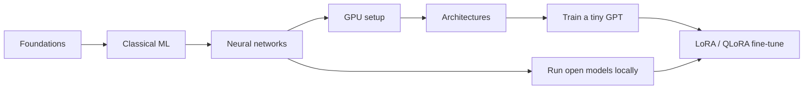

# Learning roadmap

This page is the path through the material, with a milestone at the end of each stage. A milestone is something you can *do*, not something you've read.

## Stage 1: The core idea

Read [What is machine learning?](./foundations/what-is-ml.md), [The core loop](./foundations/the-core-loop.md) and [The maths you actually need](./foundations/maths-you-need.md).

**Milestone:** In plain Python (no libraries), fit a straight line to some noisy points using gradient descent, and plot the loss going down.

## Stage 2: Classical ML

Work through Part 2.

**Milestone:** Train a logistic regression classifier from scratch with NumPy, then train the same thing with scikit-learn and check you get similar accuracy. Explain why test accuracy is lower than training accuracy.

## Stage 3: Neural networks and PyTorch

Work through Part 3 and set up your GPU using [Setting up your machine](./hardware/overview.md).

**Milestone:** Train a small multi-layer network on MNIST using PyTorch on your GPU (CUDA or MPS), reaching about 98% test accuracy. Write the training loop yourself, without a high-level trainer.

## Stage 4: A quick win with real models

Read [Running models locally](./open-source-models/running-locally.md).

**Milestone:** Chat with a 7–8B parameter model running on your own GPU through Ollama or llama.cpp. Notice how fast it is, and how much memory it uses. On the Mac, try a 27–32B model too and compare.

## Stage 5: Architectures

Work through Part 4.

**Milestone:** Implement a single self-attention head from scratch in PyTorch and check its output shape on a toy batch. Train a small CNN on CIFAR-10.

## Stage 6: Training from scratch

Work through Part 5.

**Milestone:** Train a character-level or small BPE GPT (about 10M parameters) on a text corpus of your choice, and sample text from it. Watch it go from gibberish to something that looks like the training data.

## Stage 7: Fine-tuning open models

Work through Part 6.

**Milestone:** QLoRA fine-tune a 1–3B parameter instruction model on a small dataset of your own (on the 3070 with bitsandbytes, or on the Mac with MLX). Compare its answers to the base model's on prompts it hasn't seen.

## After that

Some directions once the basics are solid:

- **Go deeper on LLMs:** preference tuning (DPO), evaluation, retrieval-augmented generation (RAG).
- **Go wider:** image generation (diffusion models), speech (Whisper), reinforcement learning.
- **Go lower-level:** write your own autograd engine (see [micrograd](https://github.com/karpathy/micrograd)), or profile and optimise a training run.

Keep a log in `notes/` of what you tried and what surprised you. Surprises are where the learning is.
